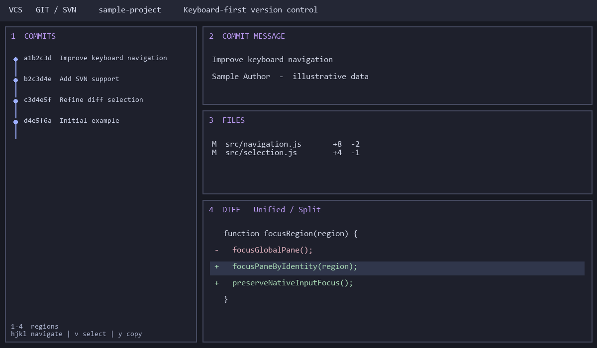

# VCS for Herdr

同时支持 **SVN 和 Git** 的 Herdr 原生版本控制面板，支持**全键盘操作**。



四区域布局：提交历史、提交信息、文件树和差异视图。支持多个 pane、跨 tab 使用、统一/并排 diff、文本选择、搜索和引用到剪贴板。

## Install

Requires Herdr 0.1.11, herdr-core, PowerShell 7 (`pwsh`), and Git and/or SVN on PATH. The automatic pane identity binding helper currently requires PowerShell 7; this package has been tested on Windows.

Copy `mods/vcs` into your Herdr app home. If that mod name already exists, back it up and review changes before replacing it. Open with:

```powershell
herdr-app do pane.split --direction right --mod vcs
```

Optional: merge `mods/vcs/keys.json` into your key bindings; review conflicts first. It proposes Ctrl+Shift+G for the overlay view.

## Keyboard

- `1` / `2` / `3` / `4`: focus a region (while outside text input).
- `h/j/k/l`, arrow keys: navigate the active region.
- Region 4: `v` starts/ends visual selection; `V` selects a line; `y` copies selected text; `m` opens actions; `/` searches; Escape cancels.
- `+` maximizes a region; `-` restores the layout.
- Click the repository path or use `o` to choose a repository; `v` switches Git/SVN where available outside region 4.

## Access and behavior

This is trusted executable mod code. It runs Git/SVN through `hc exec`, reads repository files, watches local folders, and performs version-control writes only through its controls. SVN log and other user-requested VCS operations can contact repository servers. Agent integration can focus an agent and paste selected text.

`bind-panes.ps1` fills `vcsPane` metadata in VCS pane props through the core's version-checked `herdr-app` document API. It preserves pane IDs, splits, terminals and other props; original document backups stay locally under `data/vcs-pane-bindings`. The helper uses `hc connect` and never publishes these backups.

The preview uses invented sample data. This package contains no personal configuration, repository histories, screenshots of private work, core documents or credentials. No analytics or upload feature is added by this mod.
