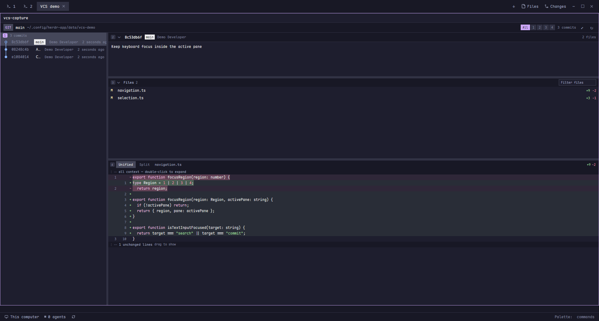

# VCS

A native four-region version-control pane for Herdr, simultaneously supporting Git and SVN repositories with full keyboard operation. The preview is a real Herdr window capture of a local demo repository with fictional code and author, not a drawn mockup.

## What you see

A 32px header with VCS kind, repository path, layout controls, commit count and refresh. Left: a 340px resizable commit graph with 24px rows. Right: commit message (110px), file tree (230px), and the remaining height as a diff. Splitters are 6px. Region chips 1–4 identify the keyboard region. Theme-derived colors and terminal font follow Herdr. Diff text is 11.5px; rows are 18px. Active regions use accent chips and selected header backgrounds. Diff supports unified and side-by-side views, syntax colors and expanded context.

## How it behaves

The pane pins its repository until explicitly changed. Git and SVN can be selected for a folder containing both. Graph/file requests are asynchronous; folder event bursts are debounced 350ms. Each pane stores its own `vcsPane` identity in props; focus handoff checks that exact identity, capture state and active inputs. Hidden instances record pane focus edges every 75ms without redraw or repository work. Native focus handoff is deferred 32ms. Agent working/blocked/done/idle status does not recolor the graph; those states are owned by Herdr. The Send to agent action chooses the focused agent, else an idle agent, else the first available agent.

1–4 focus the regions outside editors; hjkl/arrows navigate. Region 4 uses v for visual selection, V for a whole line, y to copy, m for an actions menu, / for search and Escape to cancel. Mouse drag selects text; double click selects a word. + maximizes the region; - restores. Header and region splitters resize the view. Commit/stage/revert actions change the repository and must report failures. Text inputs retain text-entry behavior.

## Built from

`mods/vcs/main.js` exports a gpui-kit View. `lanes.js` lays out the commit graph; `mod.json` declares a hidden-by-default pane and overlay; `keys.json` proposes the opener. The view uses focus handles, native inputs, virtual lists and scroll handles. It calls herdr live model APIs, theme/settings, folder watching, read/write files, hc, run, clipboard, notifications and overlays. No shipped layout is changed.

`bind-panes.ps1` uses hc connect doc.get/doc.set with compare-and-swap, adds only content.props.vcsPane to VCS nodes, retries conflicts and saves backups under the app data folder. Missing identity triggers this helper only after native root layout. Existing props are preserved. All repository operations run through hc exec using Git/SVN arguments.

## Watch out

PowerShell 7 and hc must be installed. Binding requires a reachable core document; failures must be visible. Never guess instance identity from the globally focused pane or total pane count: several panes may exist in other tabs. Native focus calls cannot run in render/layout; cx.spawn runs synchronously before its first await. Record root mount on the root, not a conditional diff child. Avoid refocusing a handle already focused during mouse selection. Never poll repository data to animate. Limits: 300 commits, 3000 diff lines, 64KiB untracked preview. Remote behavior is supported by APIs but the multi-pane native regression was run on Windows locally; do not claim remote native UI validation. Shipped text typings and personal state do not belong in the package.

## Done when

herdr-app check mods/vcs passes. Multiple VCS panes in one tab and across tabs accept 1–4/hjkl only in the focused pane. Returning to a hidden tab restores keyboard operation. A menu or input keeps its keyboard. Region 4 visual selection contains actual text, mouse drag selects, and double-click selects a word. Closing test panes leaves pre-existing terminals and layout intact. Git/SVN selection, graph, file tree and diff are present. The public package contains only mod source, its documentation and real demo screenshot.
